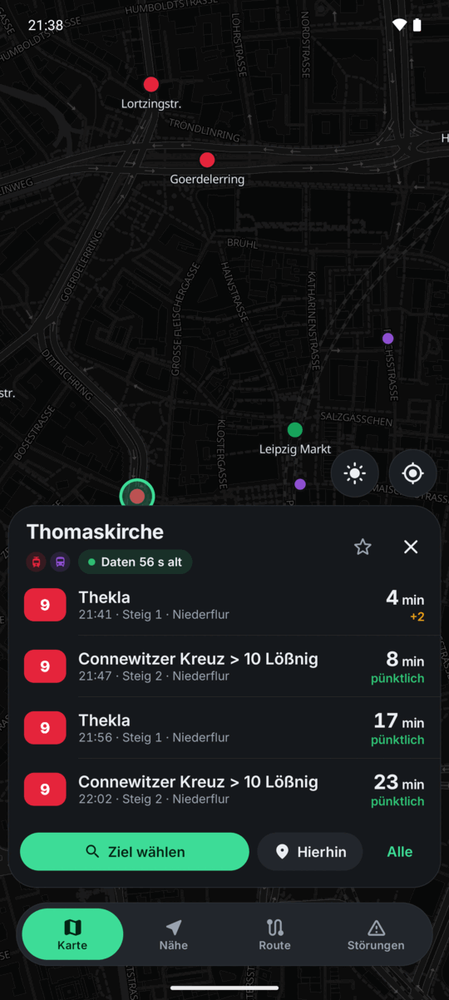
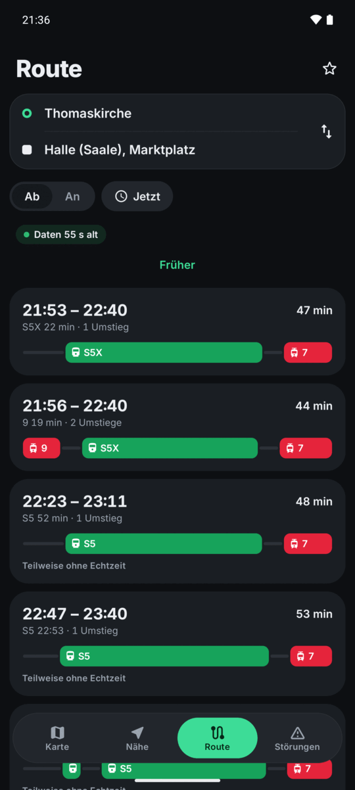
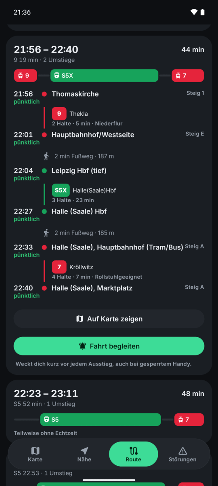
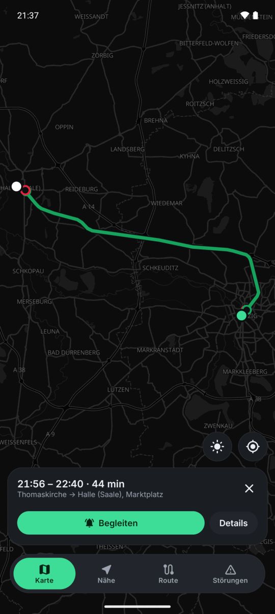
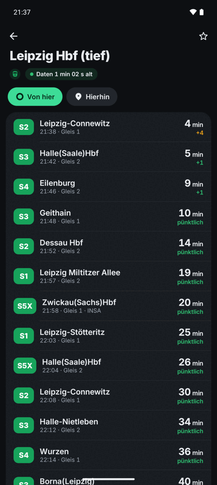
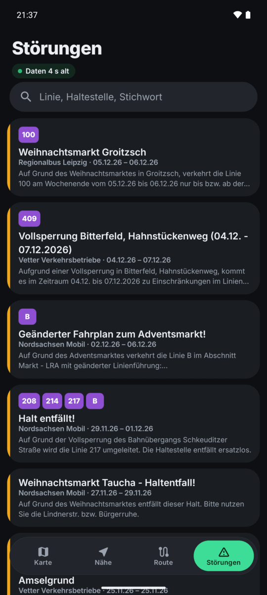

# Takt

A fast, robust transit app for Leipzig and the MDV area (tram, bus, S-Bahn, regional trains), with live delays and cancellations. Native Android app plus a small self-hosted backend. No Google Play services.

| Map | Journeys | Journey detail |
|---|---|---|
|  |  |  |
| **Route on the map** | **Departures** | **Disruptions** |
|  |  |  |

## Why

The official app is slow and freezes on bad mobile networks. It also cannot pick a nearby stop as the start of a journey. Takt keeps static data on the phone, loads only what is on screen, never blocks the UI, and always shows how old the live data is.

## Parts

| Part | What it does |
|---|---|
| `server/` (container **Takt**) | Downloads the open DELFI timetables from gtfs.de (`nv_free` = bus/tram, `rv_free` = S-Bahn/regional rail) weekly and OpenStreetMap monthly, and cuts both to the configured area. It polls the DELFI GTFS-Realtime feed, keeps only trips in the area and serves the result to MOTIS. It also provides a small JSON API for the app. INSA HAFAS (unofficial) is used sparingly for train platforms, realtime gaps and disruption messages, and as a fallback when MOTIS is down. |
| MOTIS (container **Takt-MOTIS**) | Official `ghcr.io/motis-project/motis` image. It runs `run.sh`, which the Takt container writes. The script re-imports whenever Takt publishes new data and switches over without downtime. It provides departures, journey planning and address search. |
| `android/` | Kotlin + Jetpack Compose app. It includes nearby stops (offline, by GPS), a map of all stops (MapLibre + OpenFreeMap) where tapping a stop shows its departures, a departure board, journey planning with realtime, trip details, disruptions, and favourite stops and journeys. |
| `unraid/` | Unraid templates for both containers. |
| `phase0/` | Initial data check: realtime coverage of the open feed for Leipzig (`FINDINGS.md`). |

## Data age

Every live view shows a chip such as `Daten 42 s alt` or `Daten 3 min 05 s alt` that ticks every second. The value is the age of the realtime data: the feed age reported by the server plus the time since the app received it. Green means under 90 s, amber under 5 min, red above that. Data from the local cache is marked `offline`.

## Robust networking

- The app uses 3 s connect and 7 s read timeouts, two quick retries with backoff, and cancellable calls.
- Departures per stop are cached on disk and shown instantly, then refreshed every 20 s while visible.
- Stops and coordinates are bundled in the APK and updated by ETag, so the nearby list, search and the map dots work without network.
- The server polls the large (~6 MB) realtime feed every 30 s only while the app is in use, otherwise every 5 min.

## API (server)

| Endpoint | |
|---|---|
| `GET /api/v1/stations` | all stops `[id, name, lat, lon, modes, mergedIds, weight]`, ETag |
| `GET /api/v1/departures?station=ID&n=40` | departures with `t` (planned), `rt` (realtime or null), `cancelled`, `track`, `src` |
| `GET /api/v1/plan?from=ID|lat,lon&to=…&time=&arriveBy=1&cursor=` | journeys |
| `GET /api/v1/trip?id=` | stops of one trip |
| `GET /api/v1/alerts` | disruption messages in the area |
| `GET /api/v1/vehicles?min=lat,lon&max=lat,lon&zoom=` | running trips in a box (MOTIS railviz): stop-to-stop pieces with realtime times and path; the app moves the vehicles along them |
| `GET /api/v1/geocode?text=` | addresses and places |
| `GET /api/v1/status` | data state, realtime stats, MOTIS health |

Bearer token per person in `DATA/tokens.txt` (`./tokens.sh add NAME`), or a single `API_TOKEN`.

**Without a token the API has no login.** It then answers only in the LAN/VPN and refuses requests that came through a proxy. To share the app with friends over the internet, see [docs/public-access.md](docs/public-access.md) (NetBird reverse proxy, per-person tokens, rate limits).

## Deploy

The server image `ghcr.io/noronus/takt` is built for every release (`:latest`, `:0.4.0`, `:0.4`). On Unraid the template `unraid/my-Takt.xml` uses it, so updates show up in the Docker tab. `unraid/takt-autoupdate.sh` checks the Takt and Takt-MOTIS images every 5 minutes and installs updates (a `--local` image is left alone).

```sh
cp deploy.env.example deploy.env   # SSH target, host address, ports
./deploy.sh                        # pull the image on the host, install templates + 5-min auto update, (re)create containers
./deploy.sh --local                # build from this checkout instead and upload it (unreleased changes)
./deploy.sh --motis                # also recreate the MOTIS container
```

The first start downloads ~600 MB (GTFS + OSM) and builds the data in about 10 minutes. The MOTIS import then takes about one minute.

## App

**Download:** the APK is attached to the [latest release](https://github.com/Noronus/takt/releases/latest). One APK for everyone. It needs a personal access token from the server owner (Settings → Zugangs-Token).

Build it yourself:

```sh
cd android
./gradlew assembleRelease -PtaktServer=http://HOST:8097   # default server, can be changed in the app
adb install -r app/build/outputs/apk/release/app-release.apk
```

Signing uses `android/keystore.properties` and the keystore it names. Neither is tracked by git. Before a build, copy `server` output `static/stations.json` to `android/app/src/main/assets/` to bundle a current stop list.

## License

MIT, see `LICENSE`. Bundled fonts, map styles and data have their own licenses, see `THIRD_PARTY_NOTICES.md`.

## Licenses of the data

- Timetable and realtime: DELFI e.V. via gtfs.de, CC BY 4.0 (realtime CC BY-SA 4.0)
- Map: © OpenStreetMap contributors (ODbL), tiles by OpenFreeMap
- INSA HAFAS is an unofficial interface. Use it privately and sparingly.
